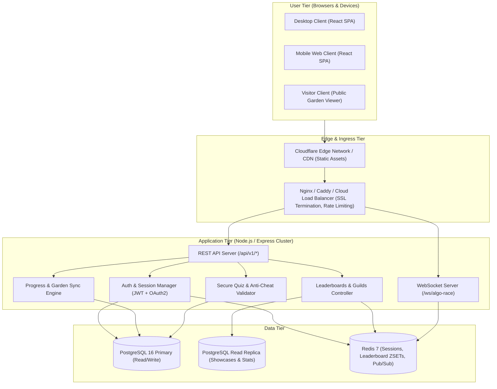
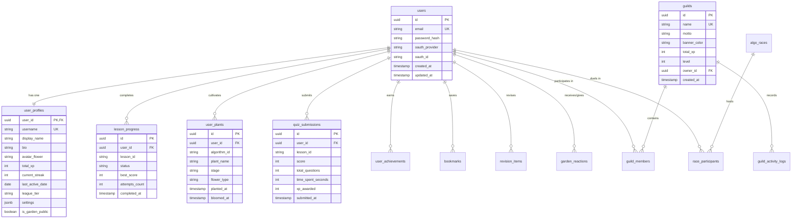
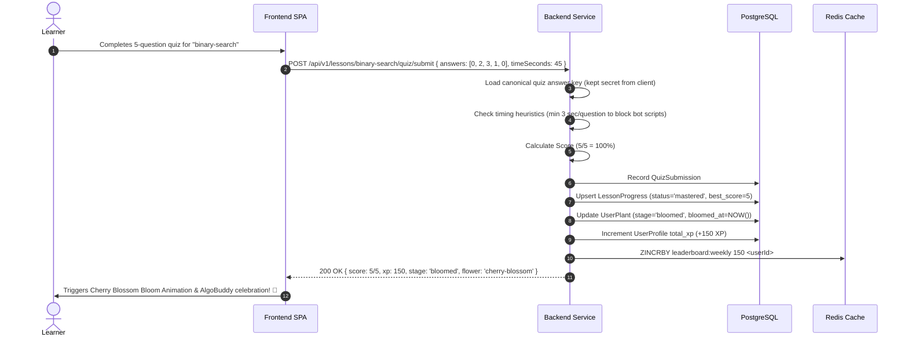

# System Design Document 🌸
# AlgoBloom: Multi-User Architecture & Database Specification

- **System Version:** 2.0.0
- **Architectural Style:** Decoupled Client-Server (Vite React SPA + Express/Node.js REST/WS API + PostgreSQL + Redis)
- **Status:** Approved / In Implementation

---

## 1. System Architecture & High-Level Topology

AlgoBloom 2.0 adopts a decoupled client-server architecture. The frontend remains a lightning-fast Vite Single Page Application (SPA), while a dedicated Node.js/Express backend handles state persistence, secure anti-cheat quiz evaluation, user authentication, social leaderboards, and real-time multiplayer duels over WebSockets.



---

## 2. Technology Stack & Justification

| Layer | Technology | Key Selection Rationale |
| :--- | :--- | :--- |
| **Frontend** | React 18, Vite, TypeScript, Tailwind CSS | Already built, 60 FPS visualizers, zero build friction, fast reactive UI. |
| **State & Sync** | TanStack Query v5 + Zustand | Robust query caching, automatic retries, optimistic updates, offline mutation queue. |
| **Backend API** | Node.js, Express, TypeScript | End-to-end TypeScript code sharing (`types/index.ts`), non-blocking I/O for high concurrency. |
| **Realtime Engine** | `ws` / `Socket.io` over Node.js | Low-latency state synchronization for AlgoRace (1v1 duels) and live garden visitor reactions. |
| **Primary Database** | PostgreSQL 16 | Relational integrity for user curriculum, progress graphs, transactions for quiz scores, JSONB for flexible trace telemetry. |
| **Caching & In-Memory**| Redis 7 | High-performance sorted sets (`ZSET`) for sub-millisecond weekly leaderboards; Pub/Sub for multi-server WebSocket broadcasting. |
| **ORM / Query Builder**| Prisma ORM | Type-safe queries matching TypeScript models, automated migrations, self-documenting schema. |
| **Auth** | JWT (RS256) + httpOnly Cookie | Stateless API verification with secure CSRF protection and refresh token revocation. |

---

## 3. Comprehensive Database Schema

### 3.1. Entity Relationship (ER) Diagram



---

### 3.2. Prisma Schema Definition (`prisma/schema.prisma`)

```prisma
datasource db {
  provider = "postgresql"
  url      = env("DATABASE_URL")
}

generator client {
  provider = "prisma-client-js"
}

enum Role {
  USER
  EDUCATOR
  ADMIN
}

enum LeagueTier {
  SEEDLING
  SPROUT
  BUDDING
  BLOSSOM
  ANCIENT_GROVE
}

enum PlantStage {
  SEED
  SPROUT
  BUD
  BLOOMED
}

enum GuildRole {
  OWNER
  OFFICER
  MEMBER
}

model User {
  id            String    @id @default(uuid())
  email         String    @unique
  passwordHash  String?   @map("password_hash")
  oauthProvider String?   @map("oauth_provider")
  oauthId       String?   @map("oauth_id")
  role          Role      @default(USER)
  createdAt     DateTime  @default(now()) @map("created_at")
  updatedAt     DateTime  @updatedAt @map("updated_at")

  profile           UserProfile?
  lessonProgress    LessonProgress[]
  plants            UserPlant[]
  quizSubmissions   QuizSubmission[]
  achievements      UserAchievement[]
  bookmarks         Bookmark[]
  revisionItems     RevisionItem[]
  givenReactions    GardenReaction[]   @relation("Giver")
  receivedReactions GardenReaction[]   @relation("Receiver")
  guildMembership   GuildMember?
  raceParticipations RaceParticipant[]

  @@map("users")
}

model UserProfile {
  userId          String      @id @map("user_id")
  user            User        @relation(fields: [userId], references: [id], onDelete: Cascade)
  username        String      @unique
  displayName     String      @map("display_name")
  bio             String?     @default("Growing in algorithmic confidence 🌸")
  avatarFlower    String      @default("daisy") @map("avatar_flower")
  totalXp         Int         @default(0) @map("total_xp")
  currentStreak   Int         @default(0) @map("current_streak")
  lastActiveDate  DateTime    @default(now()) @map("last_active_date")
  leagueTier      LeagueTier  @default(SEEDLING) @map("league_tier")
  isGardenPublic  Boolean     @default(true) @map("is_garden_public")
  settings        Json        @default("{\"darkMode\":false,\"animationSpeed\":\"normal\",\"soundEnabled\":true,\"fontSize\":\"normal\",\"buddyVisible\":true}")
  createdAt       DateTime    @default(now()) @map("created_at")
  updatedAt       DateTime    @updatedAt @map("updated_at")

  @@index([totalXp(sort: Desc)])
  @@index([currentStreak(sort: Desc)])
  @@map("user_profiles")
}

model LessonProgress {
  id            String    @id @default(uuid())
  userId        String    @map("user_id")
  user          User      @relation(fields: [userId], references: [id], onDelete: Cascade)
  lessonId      String    @map("lesson_id")
  status        String    @default("in_progress") // "started", "completed", "mastered"
  bestScore     Int       @default(0) @map("best_score")
  attemptsCount Int       @default(1) @map("attempts_count")
  completedAt   DateTime? @map("completed_at")
  updatedAt     DateTime  @updatedAt @map("updated_at")

  @@unique([userId, lessonId])
  @@index([userId])
  @@map("lesson_progress")
}

model UserPlant {
  id          String      @id @default(uuid())
  userId      String      @map("user_id")
  user        User        @relation(fields: [userId], references: [id], onDelete: Cascade)
  algorithmId String      @map("algorithm_id")
  plantName   String      @map("plant_name")
  stage       PlantStage  @default(SEED)
  flowerType  String      @map("flower_type")
  plantedAt   DateTime    @default(now()) @map("planted_at")
  bloomedAt   DateTime?   @map("bloomed_at")

  @@unique([userId, algorithmId])
  @@index([userId])
  @@map("user_plants")
}

model QuizSubmission {
  id                String    @id @default(uuid())
  userId            String    @map("user_id")
  user              User      @relation(fields: [userId], references: [id], onDelete: Cascade)
  lessonId          String    @map("lesson_id")
  score             Int
  totalQuestions    Int       @default(5) @map("total_questions")
  answersPayload    Json      @map("answers_payload")
  timeSpentSeconds  Int       @map("time_spent_seconds")
  xpAwarded         Int       @map("xp_awarded")
  submittedAt       DateTime  @default(now()) @map("submitted_at")

  @@index([userId, lessonId])
  @@map("quiz_submissions")
}

model UserAchievement {
  id            String    @id @default(uuid())
  userId        String    @map("user_id")
  user          User      @relation(fields: [userId], references: [id], onDelete: Cascade)
  achievementId String    @map("achievement_id")
  unlockedAt    DateTime  @default(now()) @map("unlocked_at")

  @@unique([userId, achievementId])
  @@map("user_achievements")
}

model Bookmark {
  id          String    @id @default(uuid())
  userId      String    @map("user_id")
  user        User      @relation(fields: [userId], references: [id], onDelete: Cascade)
  algorithmId String    @map("algorithm_id")
  createdAt   DateTime  @default(now()) @map("created_at")

  @@unique([userId, algorithmId])
  @@map("bookmarks")
}

model RevisionItem {
  id                 String    @id @default(uuid())
  userId             String    @map("user_id")
  user               User      @relation(fields: [userId], references: [id], onDelete: Cascade)
  lessonId           String    @map("lesson_id")
  algorithmTitle     String    @map("algorithm_title")
  reason             String
  incorrectQuestions Json      @map("incorrect_questions")
  addedAt            DateTime  @default(now()) @map("added_at")

  @@unique([userId, lessonId])
  @@map("revision_items")
}

model GardenReaction {
  id          String    @id @default(uuid())
  giverId     String    @map("giver_id")
  giver       User      @relation("Giver", fields: [giverId], references: [id], onDelete: Cascade)
  receiverId  String    @map("receiver_id")
  receiver    User      @relation("Receiver", fields: [receiverId], references: [id], onDelete: Cascade)
  reactionType String   @map("reaction_type") // "blossom", "bee", "water"
  createdAt   DateTime  @default(now()) @map("created_at")

  @@index([receiverId])
  @@map("garden_reactions")
}

model Guild {
  id          String        @id @default(uuid())
  name        String        @unique
  motto       String?
  bannerColor String        @default("#F1B4B1") @map("banner_color")
  totalXp     Int           @default(0) @map("total_xp")
  level       Int           @default(1)
  ownerId     String        @map("owner_id")
  createdAt   DateTime      @default(now()) @map("created_at")
  members     GuildMember[]

  @@map("guilds")
}

model GuildMember {
  id        String    @id @default(uuid())
  guildId   String    @map("guild_id")
  guild     Guild     @relation(fields: [guildId], references: [id], onDelete: Cascade)
  userId    String    @unique @map("user_id")
  user      User      @relation(fields: [userId], references: [id], onDelete: Cascade)
  role      GuildRole @default(MEMBER)
  joinedAt  DateTime  @default(now()) @map("joined_at")

  @@map("guild_members")
}

model AlgoRace {
  id           String            @id @default(uuid())
  roomCode     String            @unique @map("room_code")
  algorithmId  String            @map("algorithm_id")
  status       String            @default("waiting") // "waiting", "in_progress", "finished"
  createdAt    DateTime          @default(now()) @map("created_at")
  participants RaceParticipant[]

  @@map("algo_races")
}

model RaceParticipant {
  id         String    @id @default(uuid())
  raceId     String    @map("race_id")
  race       AlgoRace  @relation(fields: [raceId], references: [id], onDelete: Cascade)
  userId     String    @map("user_id")
  user       User      @relation(fields: [userId], references: [id], onDelete: Cascade)
  finalScore Int       @default(0) @map("final_score")
  rank       Int?
  finishedAt DateTime? @map("finished_at")

  @@unique([raceId, userId])
  @@map("race_participants")
}
```

---

## 4. API Interface Specifications

### 4.1. Authentication & Onboarding
- `POST /api/v1/auth/register`
  - Body: `{ email, password, username, displayName }`
  - Response: `{ user: { id, email, username }, token: string }`
- `POST /api/v1/auth/login`
  - Body: `{ email, password }`
  - Response: `{ user: UserProfile, token: string }`
- `GET /api/v1/auth/me`
  - Headers: `Authorization: Bearer <token>`
  - Response: `{ user: UserProfile, progressSummary: object }`
- `POST /api/v1/auth/sync-guest`
  - Merges guest `localStorage` data into the newly created account.
  - Body: `{ guestProgress: UserProgress }`
  - Response: `{ success: true, updatedProgress: UserProgress }`

### 4.2. Progress & Botanical Garden Sync
- `GET /api/v1/progress`
  - Retrieves full authenticated user progress matching the frontend `UserProgress` contract.
- `PUT /api/v1/progress/settings`
  - Body: `{ darkMode, animationSpeed, soundEnabled, fontSize, buddyVisible }`
- `POST /api/v1/progress/plant`
  - Body: `{ algorithmId, flowerType, plantName }`
  - Transitions plant state from unplanted → seed.

### 4.3. Anti-Cheat Quiz Evaluation
- `POST /api/v1/lessons/:lessonId/quiz/submit`
  - Body:
    ```json
    {
      "answers": [1, 3, 0, 2, 1],
      "timeSpentSeconds": 42
    }
    ```
  - Response:
    ```json
    {
      "score": 5,
      "totalQuestions": 5,
      "xpEarned": 100,
      "plantUpdated": {
        "algorithmId": "binary-search",
        "stage": "bloomed",
        "flowerType": "cherry-blossom"
      },
      "unlockedAchievements": ["binary-blossom"],
      "explanations": ["Correct! Halving takes O(log n)..."]
    }
    ```

### 4.4. Social Showcases & Leaderboards
- `GET /api/v1/users/@:username`
  - Returns public profile metadata, botanical badges, and streak statistics.
- `GET /api/v1/users/@:username/garden`
  - Returns public garden layout: array of bloomed and sprouting flowers with dates and mastery badges.
- `POST /api/v1/users/@:username/react`
  - Body: `{ reactionType: "blossom" | "bee" | "water" }`
- `GET /api/v1/leaderboard/weekly`
  - Returns top 50 users sorted by weekly XP.
- `GET /api/v1/leaderboard/all-time`
  - Returns top 50 users sorted by total XP.

### 4.5. Garden Guilds
- `GET /api/v1/guilds` (Browse guilds)
- `POST /api/v1/guilds` (Create new guild)
- `POST /api/v1/guilds/:id/join` (Join guild)
- `GET /api/v1/guilds/:id` (Get guild profile, members, and communal greenhouse progress)

### 4.6. Realtime WebSocket Protocol (`/ws/algo-race`)
| Event | Direction | Payload |
| :--- | :--- | :--- |
| `RACE_JOIN` | Client → Server | `{ roomCode, userId }` |
| `RACE_START` | Server → Client | `{ countdown: 3, algorithmId, questions }` |
| `PLAYER_PROGRESS`| Client → Server | `{ questionIndex, correct }` |
| `LEADERBOARD_UPDATE`| Server → Client | `{ players: [{ userId, username, progressPercent, score }] }` |
| `RACE_FINISH` | Server → Client | `{ winnerId, rankings: [...] }` |

---

## 5. Sequence & Data Flow Diagrams

### 5.1. Guest-to-Registered Progress Migration

```mermaid
sequenceDiagram
    autonumber
    actor Learner as User (Browser)
    participant Client as AlgoBloom SPA (React)
    participant API as AlgoBloom Backend (Express)
    participant DB as PostgreSQL Database

    Note over Learner,Client: Learner has completed 2 lessons as Guest
    Learner->>Client: Clicks "Sign Up & Save Garden"
    Client->>Learner: Displays Modal (Email, Password, Username)
    Learner->>Client: Submits Registration Form
    Client->>Client: Reads guest state from localStorage (XP: 220, 2 plants)
    Client->>API: POST /api/v1/auth/register-with-sync { email, password, guestProgress }
    
    rect rgb(240, 248, 255)
        API->>DB: BEGIN TRANSACTION
        API->>DB: INSERT INTO users (email, password_hash)
        API->>DB: INSERT INTO user_profiles (username, total_xp, streak)
        API->>DB: INSERT INTO lesson_progress (batch insert completed lessons)
        API->>DB: INSERT INTO user_plants (batch insert garden plants)
        API->>DB: COMMIT TRANSACTION
    end

    API-->>Client: 201 Created { token, userProfile, syncedProgress }
    Client->>Client: Clears local guest mock; switches StorageAdapter to CloudApiAdapter
    Client-->>Learner: Shows Confetti & "Garden Saved to Cloud! 🌸"
```

---

### 5.2. Anti-Cheat Quiz Grading & Botanical Blooming



---

## 6. Security, Anti-Cheat & Reliability Architecture

1. **Answer Masking:** Static quiz files in frontend contain question text and choices, but never `correctIndex`. All answer keys are stored exclusively in backend memory / database.
2. **Timing & Heuristic Validation:**
   - Any quiz submission completed in `< 5 seconds` total is flagged for telemetry audit.
   - Submissions require signed session nonces to prevent replay attacks.
3. **Rate Limiting:**
   - Standard API: 120 requests / minute per IP.
   - Quiz Submission: 6 attempts / 5 minutes per user.
   - Auth endpoints: 5 failed logins / 15 minutes per IP (blocks brute-force).
4. **Data Isolation (Row-Level Security):**
   - Users can only mutate their own `lesson_progress`, `user_plants`, and `settings`.
   - Public garden endpoints only return sanitized, read-only data fields (no private settings or email).

---

## 7. Deployment, Scalability & Infrastructure

- **Containerization:** Single multi-stage `Dockerfile` producing a lightweight (<120MB) Alpine production image for the backend.
- **Frontend Hosting:** Global edge distribution via Cloudflare Pages or Vercel with stale-while-revalidate caching.
- **Database Scaling:** PostgreSQL hosted on managed instance (RDS / Supabase) with pgBouncer connection pooling supporting up to 10,000 active concurrent connections.
- **Redis Cluster:** High availability Redis cluster for leaderboard sorted sets and pub/sub race rooms.
